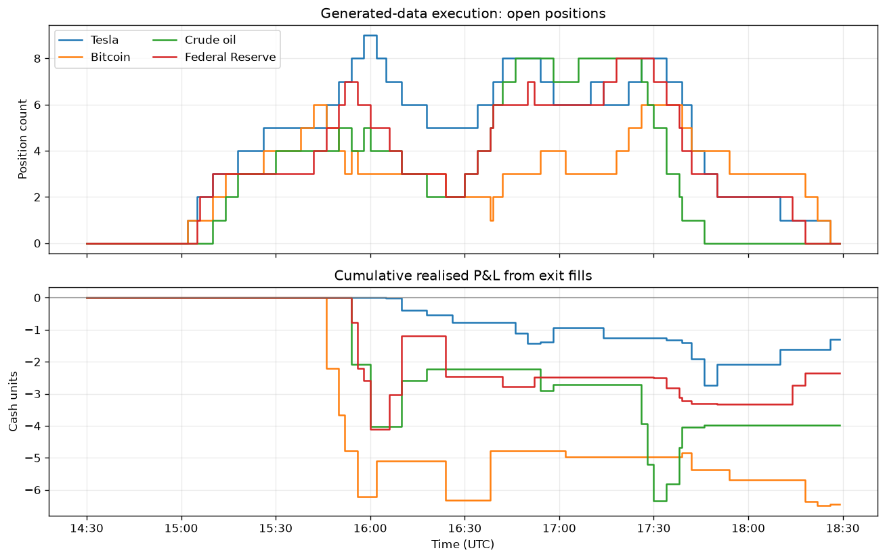

# Prediction Market Research Framework

I study whether moves in financial markets reach related prediction-market contracts with a delay, and whether that delay could be traded after accounting for spreads, stale quotes and available liquidity.

This repository is a reproducible methodology example from that work. The main notebook follows a candidate signal through entry checks, order-book fills, multiple open positions and trade accounting, using Tesla, Bitcoin, crude oil and a Federal Reserve decision as four economic mappings.

All prices and order books shown here are synthetic. The four-case generator includes a delayed price response by construction: the results demonstrate how the engine behaves, not evidence that any of these markets has a tradable lag. Signal windows, sizing and execution parameters are illustrative rather than a replay of historical research results.

Start with the [four-case execution notebook](notebooks/04_multi_position_execution_backtest.ipynb) for the complete example, including saved tables and charts.

## Research Question

Can movements in related financial markets provide useful information about the pricing of prediction-market contracts around discrete events?

I use the framework to investigate:

- aligning asynchronous market data safely
- handling stale prediction-market observations
- building rolling statistics without lookahead bias
- modelling transaction costs and spread-aware execution
- testing simple event-driven trade mechanics
- tracking inventory and exposure in a market-making setting
- documenting limitations before interpreting results

## What I Show Here

- Python market-data handling with `pandas` and `numpy`
- timestamp-safe joins between synthetic financial and prediction-market data
- rolling means, volatility estimates, and z-scores
- simple example signals
- event-driven backtesting structure
- transaction-cost, fill, and spread-aware P&L accounting
- multi-position trade ledgers with outcome-specific end-of-window handling
- capped exposure and inventory bookkeeping
- market-making simulator skeleton
- research hygiene around overfitting, stale data, and lookahead bias

## Four Illustrative Cases

The shared engine is demonstrated through four case-study designs:

| Case | Prediction contract | Linked financial series | Mapping |
|---|---|---|---|
| Tesla | Close above $390 at the end of June 2026 | TSLA one-minute close | Direct terminal threshold |
| Bitcoin | New all-time high by 30 September 2026 | BTC-USD one-minute close | Path-dependent barrier |
| Crude oil | New all-time high by 30 September 2026 | CL=F one-minute close | Discretely monitored barrier |
| Federal Reserve | 25 bp rate increase at the September 2026 meeting | ZT=F two-year Treasury-futures close | Inverse policy proxy |

These are related but non-identical claims. The examples therefore preserve a case-specific sign convention and limitation statement while using the same data schema, signal interface, displayed-depth fill model and position manager.

### Execution Example



Generated inputs only. The panels show open-position counts and cumulative realised P&L from exit fills, not historical strategy results. The [four-case notebook](notebooks/04_multi_position_execution_backtest.ipynb) includes the accounting summary and sample trade ledger, with any remaining positions reported separately.

## Scope

The examples cover data preparation and simulated execution. They do not include:

- live trading or order-placement code
- API keys, credentials, or authenticated endpoints
- real market-data exports
- production strategy parameters
- market-selection rules
- realised strategy performance

## Repository Layout

```text
prediction-market-research-framework/
  docs/                 Research-process notes and methodology
  notebooks/            Synthetic notebooks
  src/                  Reusable synthetic research modules
  tests/                Unit tests for core mechanics
```

## Setup

```bash
python3 -m venv .venv
source .venv/bin/activate
pip install -r requirements.txt
```

Run the tests:

```bash
PYTHONPATH=src pytest
```

## Example Usage

```python
from data.synthetic_data import make_synthetic_market_data
from data.timestamp_alignment import align_prediction_to_underlying
from features.rolling_features import add_rolling_zscore

underlying, prediction = make_synthetic_market_data(seed=7)
aligned = align_prediction_to_underlying(underlying, prediction)
features = add_rolling_zscore(aligned, column="underlying_return", window=30)
```

## Notebooks

The notebooks use generated data and run without credentials. Saved tables and plots can be viewed directly on GitHub:

1. [Prediction-market signals](notebooks/01_synthetic_prediction_market_signal.ipynb): asynchronous market alignment, rolling features, example signals, and simulated P&L.
2. [Event backtest](notebooks/02_synthetic_event_backtest.ipynb): event windows, one-position-at-a-time trade logging, transaction costs, and validation split structure.
3. [Market-making skeleton](notebooks/03_market_making_backtester_skeleton.ipynb): synthetic fair value, bid/ask quoting, fills, inventory, costs, and mark-to-market accounting.
4. [Four-case execution engine](notebooks/04_multi_position_execution_backtest.ipynb): four-case illustration of the modular engine, including sign adjustment, rolling discrepancy signals, displayed-depth fills, partial exits, multiple open positions and outcome-specific final close attempts.

## Disclaimer

This is a research project, not a live trading system or investment recommendation. The synthetic examples do not establish historical profitability.
